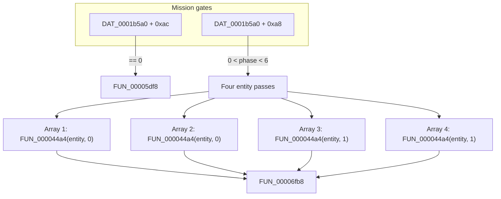
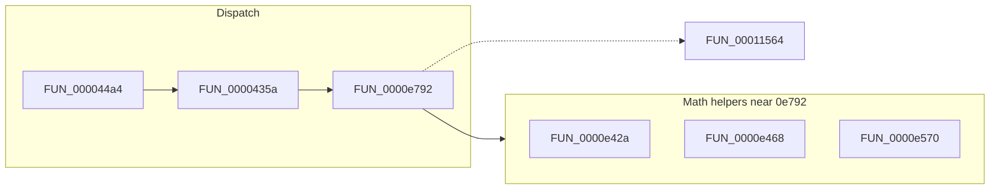
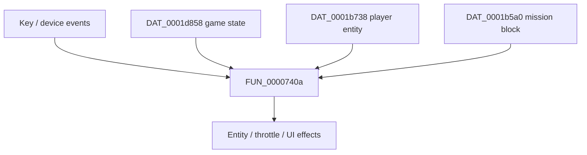
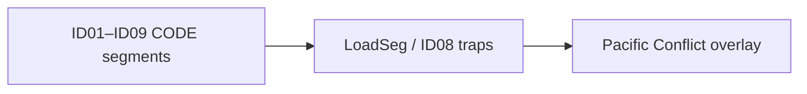

# Subsystem map (Hellcats decompilation ↔ Godot)

Tags: **[RECONSTRUCTED]** / **[INFERRED]** / **[UNKNOWN]** / **[DEFERRED]**.

**Purpose:** One-page mental model of how the **original sim** hangs together and where it runs in **Godot**: every function below is strict-ported under `godot/strict_port/code/` and runs as the original game through the runtime ([`GAME_RUNTIME.md`](GAME_RUNTIME.md)). For symbol-level detail use `tools/re_query.py` and the per-topic contracts linked below.

**Primary source file:** `Pacific Conflict.c` (Ghidra export). **Segment/runtime:** `ID01.c`–`ID09.c` (see `docs/LOADER_CHAIN.md`).

## 1) High-level flow (main sim tick)

**[RECONSTRUCTED]** The main loop is anchored on **FUN_000044e8** (`docs/contracts/tick_FUN_000044e8_contract.md`):

**[RECONSTRUCTED]** **FUN_000044a4** calls **FUN_0000435a** then optional flag updates (`docs/contracts/tick_FUN_000044e8_contract.md`).

**[RECONSTRUCTED]** Per-entity simulation includes **FUN_0000e792** (large; `docs/contracts/flight_FUN_0000e792_contract.md`).

**Godot:** `pacific_conflict.gd` **`run_simulation_tick`** (FUN_000044e8) and **`dispatch_entity_tick`** (FUN_000044a4), run every frame by the original flight loop (ID02 `run_flight_session`).

## 2) Per-entity update (conceptual)

**[INFERRED]** **FUN_00011564** is used in many places (entity, AI, effects); full consumption graph is **[UNKNOWN]** without a dedicated pass.

**Godot:** `pacific_conflict.gd` **`update_aircraft_entity`** (FUN_0000e792) and its helpers; **`overlay_rng_next`** (FUN_00011564).

## 3) Input path (conceptual)

**Godot:** `pacific_conflict.gd` **`process_flight_input_and_outcome`** (FUN_0000740a), fed Mac key and mouse events by `godot/hellcats/toolbox/event_manager.gd` from Godot input — **`docs/briefs/input_FUN_0000740a_brief.md`**.

## 4) Mission state

**[RECONSTRUCTED]** Mission block **`DAT_0001b5a0`** fields **`+0xa8`** (phase) and **`+0xac`** (flag) gate **FUN_000044e8**’s middle section.

**Godot:** the mission block lives in the emulated memory at its original address and is read and written by the strict port itself — **`docs/contracts/mission_state_DAT_contract.md`**.

## 5) RNG (two layers)

| Layer | **[RECONSTRUCTED]** location | Notes |
|-------|------------------------------|--------|
| Segment LCG | **ID05.c** `FUN_00000728` style (`* 0x41c64e6d + 0x3039`) | `ID05.gd` **`ansi_rand`**. |
| In-overlay RNG | **FUN_00011564** (`Pacific Conflict.c`) | Many callers; order-sensitive for replay. |

See **`STRICT_PORT_FOUNDATION.md`**.

## 6) Camera

**FUN_0000739a** sits on the tick/render boundary **[RECONSTRUCTED]** (multiple call sites). **Godot** uses an authored chase camera on **`PlayerAircraft`** **[INFERRED]** — not a direct port.

## 7) ID segments vs Pacific Conflict

**[INFERRED]** Most **game-identifiable** `FUN_*` for parity work live in **Pacific Conflict.c**; **ID*** files are **runtime, RNG, loader, helpers** unless proven otherwise (`docs/LOADER_CHAIN.md`).

## Related documents

| Document | Role |
|----------|------|
| `docs/contracts/tick_FUN_000044e8_contract.md` | Tick order |
| `docs/contracts/FUN_0000435a_contract.md` | **param_2** / **0x02** branch |
| `docs/contracts/flight_FUN_0000e792_contract.md` | Entity update slice |
| `docs/contracts/input_godot_contract.md` | Godot input mapping of the removed prototype (historical) |
| `docs/contracts/mission_state_DAT_contract.md` | Mission bridge |
| `docs/STRUCTS.md` | DAT_* / offset tables |
| `docs/LOADER_CHAIN.md` | ID00–ID09 and loading |
