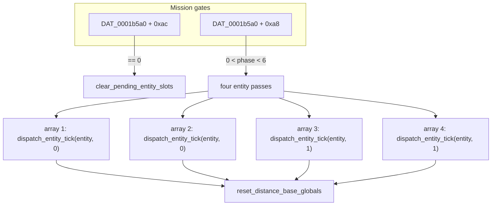

# Subsystem map

How the original program hangs together, one page. Every function named here is strict-ported
(`godot/strict_port/code/`, the module named after its segment) and runs as the original through
the runtime ([`GAME_RUNTIME.md`](GAME_RUNTIME.md)). Symbol-level detail: `tools/re_query.py`.
Confidence tags follow the vocabulary in [`../port/DECOMPILATION_PROGRESS.md`](../port/DECOMPILATION_PROGRESS.md).

## Segments

| Segment | Functions | Role |
|---|---|---|
| ID01 | 6 | the C runtime's start-up and 32-bit division |
| ID02 | 127 | the application: C library, menus and events, sound, palettes, the display, the flight session loop |
| ID03 | 45 | the cockpit instrument panel |
| ID04 | 59 | the dialogs: roster, mission selection, summary, high scores, map, About |
| ID05 | 26 | copy protection |
| ID06 | 24 | the polygon rasteriser |
| ID07 | 2 | the STR# 129 string table |
| ID08 | 4 | the scenery (overlay) loader |
| ID09 | 4 | Toolbox glue |
| Pacific Conflict | 443 | the overlay: the simulation, AI, rendering, instruments and input of a flight |

The segments are loaded through the jump table ([`LOADER_CHAIN.md`](LOADER_CHAIN.md)); ID08 loads
the Pacific Conflict overlay from the scenery file, and the overlay calls back into the host through
its service table ([`../reference/OVERLAY_SERVICE_TABLE.md`](../reference/OVERLAY_SERVICE_TABLE.md)).

## The simulation tick

**[RECONSTRUCTED]** ID02's `run_flight_session` calls the overlay's frame step every frame; the
simulation proper is `run_simulation_tick` (`FUN_000044e8`):

**[RECONSTRUCTED]** `dispatch_entity_tick` (`FUN_000044a4`) applies the entity's mission rates
(`apply_entity_mission_rates`, `FUN_0000435a`) and runs its controller; an aircraft's flight is
`update_aircraft_entity` (`FUN_0000e792`), with its table and damping helpers
(`table_lerp_1b2c0`, `damp_short_if_below_0x200`, `scale_template_field_38`).

**[STRONG INFERENCE]** `overlay_rng_next` (`FUN_00011564`) serves the entities, the AI and the
effects alike; its call order matters for replays.

## Input and mission state

**[RECONSTRUCTED]** `process_flight_input_and_outcome` (`FUN_0000740a`) reads the key and mouse
events (fed by the runtime's Event Manager), the view mode `DAT_0001d858`, the player's aircraft
`DAT_0001b738` and the mission block `DAT_0001b5a0`, whose `+0xa8` (phase) and `+0xac` (flag)
gate the tick above. The mission block lives at its original address in the runtime's memory.

## Random numbers

| Generator | Where | Notes |
|---|---|---|
| The C library's LCG (`* 0x41c64e6d + 0x3039`) | ID05 `ansi_rand` | the protection code |
| The overlay's generator | `overlay_rng_next` | order-sensitive for replays |

## Camera

**[RECONSTRUCTED]** `copy_player_pose_to_camera` (`FUN_0000739a`) sits on the boundary between the
tick and the renderer; the other views (tower, chase, tracking, replay, bail-out) have their own
routines in the overlay.
